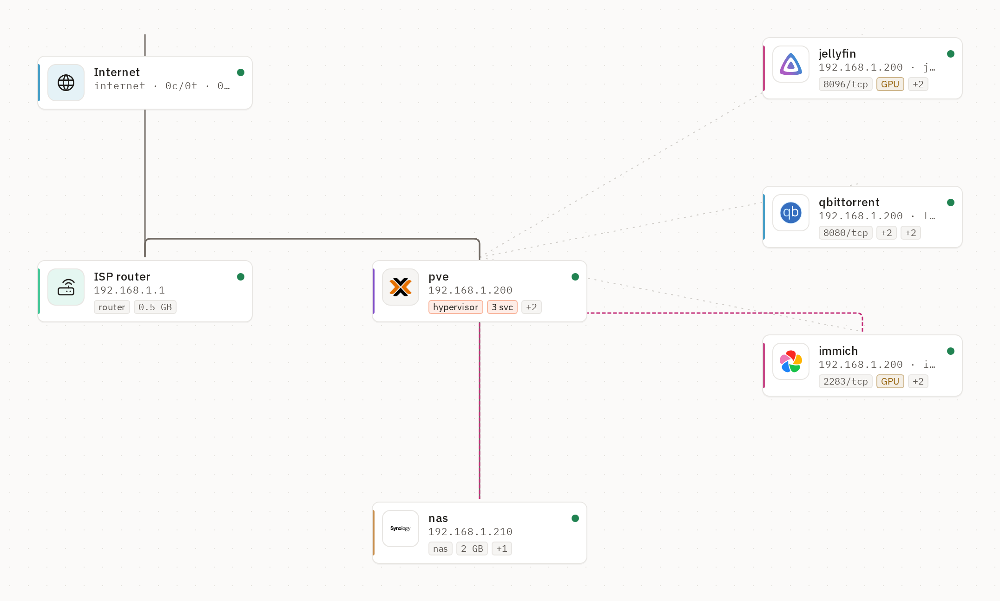
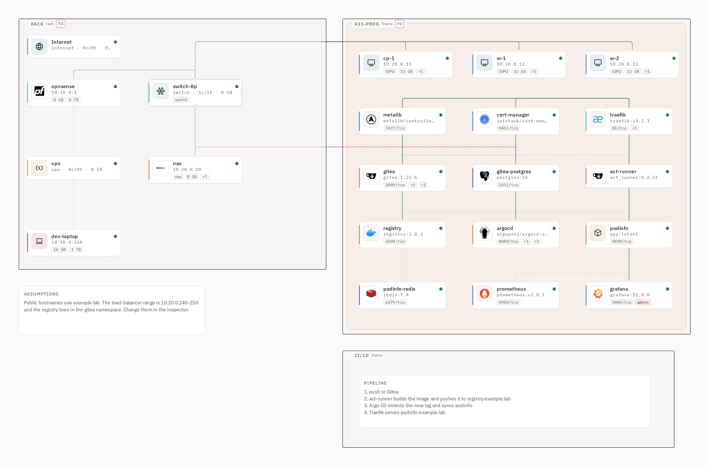

<p align="center">
  
</p>

<h1 align="center">RackDrafter</h1>

<p align="center">
  A drag-and-drop designer for home-server and homelab architectures.<br />
  Place machines and services, wire networks and tunnels, check the design, generate config.
</p>

<p align="center">
  
</p>

<p align="center">
  <a href="docs/demo.mp4">
    
  </a>
  <br />
  <sub>25 second demo. Click it for the full quality video.</sub>
</p>

RackDrafter is not an emulator: it designs, validates and generates. Think "Packet Tracer for
homelab", but declarative.

## Contents

- [Features](#features)
- [Example architectures](#example-architectures)
- [Installation](#installation)
- [How to use](#how-to-use)
- [Architecture](#architecture)
- [Configuration](#configuration)
- [Commands](#commands)
- [Status](#status)

## Features

**Canvas.** Drag from a 145-item palette (47 devices, 98 services) or press Enter to insert. Move,
multi-select, undo/redo (200 steps), snap to an 8 px grid, minimap, light and dark themes.

**Machines contain services.** Drop a service (or an LXC/VM) onto a device and it is placed there:
the host card shows how many services it carries, its inspector lists them, and a dashed tether
shows the relationship. Guests must sit on a real hypervisor, and the schema enforces it.

**Networks.** Create subnets with a purpose, VLAN, gateway and DHCP range, assign interfaces to
them, and let the allocator hand out the next free address. Ports, volumes, CPU/RAM requests and
physical resources are edited in the inspector.

**Eight link kinds.** Ethernet, Wi-Fi, VPN tunnel, reverse proxy, depends-on, replicates-to,
backup-to and mounts, each with its own defaults, styling and connection rules.

**Checks that matter.** The findings drawer runs on every edit: duplicate or out-of-subnet
addresses, overlapping subnets, host-port conflicts, RAM/CPU/disk overcommit, a missing GPU, data
with no backup, admin UIs published without auth, single-cable hosts, dependency cycles and
unpinned images. It also lists what is exposed to the internet and what the design costs in watts
and euros per month.

**Icons are real and bundled.** Service logos come from
[homarr-labs/dashboard-icons](https://github.com/homarr-labs/dashboard-icons) and
[selfh.st/icons](https://github.com/selfhst/icons), brand marks from
[Simple Icons](https://github.com/simple-icons/simple-icons), device glyphs from
[Tabler](https://github.com/tabler/tabler-icons). `npm run icons:fetch` downloads, sanitises and
pins them (SHA-256 in `icons.lock.json`); `npm run icons:verify` checks them offline. 99 logos and
69 dark-mode variants ship in the repo. Licences and trademark notices are in
[THIRD_PARTY_NOTICES.md](THIRD_PARTY_NOTICES.md).

## Example architectures

Two designs ship with the app and are seeded on first run (k3s and Homelab below). The simple media
server is a small extra you can import. You can open, edit, duplicate or delete all of them.

### Simple media server

Jellyfin, qBittorrent and Immich on one Proxmox host behind the ISP router, with Immich backed up
to a NAS through a `backup-to` link (the pink dashed line). The findings drawer reports no
data-loss warning because the stateful service has a backup. Import it into a running instance:

```bash
curl -X POST http://127.0.0.1:4747/api/projects \
  -H 'content-type: application/json' \
  --data @docs/examples/media-server.json
```



### k3s cluster with CI/CD

Three machines running k3s behind an OPNsense firewall: MetalLB, cert-manager and Traefik in front,
Gitea with a Postgres, an act-runner that pushes to a private registry, Argo CD syncing the app,
and Prometheus and Grafana on the side. The pipeline is spelled out in a note beside the cluster.



The other seeded design, **Homelab**, is a Proxmox VE 9 host on a Dell OptiPlex with its twelve
LXCs and their services, a GPU transcoder, the Steam Deck and laptop as clients, and a public
Ubuntu VPS with its Docker stack, joined by Tailscale and WireGuard-over-wstunnel. Every value
that was not documented by the owner is marked `assumed:` in the node notes.

## Installation

**Requirements:** Node.js 22.18 or newer (`.nvmrc` pins 24) and npm. No database server is needed:
data lives in one SQLite file.

```bash
git clone https://github.com/LumosDhia/rackdrafter.git
cd rackdrafter
npm ci
npm run dev
```

Open <http://127.0.0.1:4747>. The first start creates `./data/rackdrafter.db` and seeds the two
example designs.

To run the production build, which serves the built client and the API from one process:

```bash
npm run build
npm start
```

For the end-to-end tests, install the browser once:

```bash
npx playwright install --with-deps chromium
```

`npm run verify` runs the whole gate: format, types, lint, icon verification, unit tests, build,
bundle budget and end-to-end tests.

## How to use

1. **Open or create a project.** The home page lists your designs. Open one of the seeded examples
   to explore, or press **New project** for a blank canvas.
2. **Add things.** The left palette has a **Devices** tab and a **Services** tab and a search box.
   Drag an item onto the canvas, or select it and press Enter to insert it.
3. **Put services on machines.** Drop a service, LXC or VM onto a device. It is placed there, the
   host card counts it, and a dashed tether shows the relationship.
4. **Wire it up.** Drag from one node's handle to another to connect them. The **Link** selector in
   the top bar picks the kind (or leave it on `auto`): ethernet, Wi-Fi, VPN tunnel, reverse proxy,
   depends-on, replicates-to, backup-to or mounts.
5. **Describe the network.** In the inspector (right panel) add subnets with a CIDR, VLAN, gateway
   and DHCP range, assign interfaces to them, and edit ports, volumes and CPU/RAM requests.
6. **Read the findings.** The drawer at the bottom has three tabs. **Findings** lists what is wrong,
   for example "stores data but nothing backs it up". **Exposure** lists what is reachable from the
   internet. **Cost** estimates watts and euros per month. Fix the design and the finding clears.
7. **Save, share, export.** Changes autosave; the disk icon saves immediately. **Share** copies a
   read-only link (`/s/<token>`). Generated files are available from the API:

   ```bash
   curl http://127.0.0.1:4747/api/projects/<project-id>/export/compose
   ```

   Formats: `compose`, `k8s`, `ip-table`, `mermaid` and `json`.

Handy keys: Enter inserts the selected palette item, `Ctrl/Cmd+Z` undoes, `Shift+D` flips the theme.

## Architecture

One process, one port, one SQLite file.

```
src/shared/    domain model + Zod schema, catalog, link rules, seeds   (no DOM, no Node APIs)
src/server/    Fastify app, routes, SQLite via better-sqlite3 + Drizzle
src/client/    React 19 + @xyflow/react canvas, Zustand store, panels
scripts/icons/ fetch, sanitise, pin and verify the icon set
```

**API** (JSON, Zod-validated): projects CRUD, `PUT /api/projects/:id/document` with optimistic
concurrency (`baseSeq` + document hash, `409` on conflict), version snapshots and restore, share
links at `/s/:token`, `/api/health`, and export endpoints.

**Validation.** The findings come from one pure function, `analyze(project)` in
`src/shared/analysis`. It reads the design only; it never contacts the hosts or addresses you
enter, so it judges what you drew, not what is live.

## Configuration

**Auth** is off by default on loopback. Set `RACKDRAFTER_TOKEN` to require a bearer token (the
server refuses to bind a non-loopback address without one, unless `RACKDRAFTER_INSECURE=1`).

| Variable               | Default                 | Purpose                                  |
| ---------------------- | ----------------------- | ---------------------------------------- |
| `PORT`                 | `4747`                  | listen port                              |
| `HOST`                 | `127.0.0.1`             | bind address                             |
| `RACKDRAFTER_DB`       | `./data/rackdrafter.db` | SQLite file                              |
| `RACKDRAFTER_TOKEN`    | unset                   | enable bearer auth                       |
| `RACKDRAFTER_INSECURE` | unset                   | `1` allows a public bind without a token |
| `RACKDRAFTER_SEED`     | `1`                     | `0` disables first-boot seeding          |

## Commands

| Command                | What it does                                               |
| ---------------------- | ---------------------------------------------------------- |
| `npm run dev`          | server + Vite in middleware mode, one port, HMR            |
| `npm start`            | production: serves `dist/client` and the API               |
| `npm run build`        | typecheck and build the client                             |
| `npm test`             | Vitest (shared, server, client projects)                   |
| `npm run test:e2e`     | Playwright, Chromium                                       |
| `npm run verify`       | everything, in order                                       |
| `npm run icons:fetch`  | refresh bundled icons and glyphs (network)                 |
| `npm run icons:verify` | offline check of hashes, coverage and licences             |
| `npm run db:reset`     | delete the SQLite file (asks nothing: `--yes` is baked in) |

## Status

Implemented: canvas and catalog, containment, networks and address allocation, the inspector for
devices, services, links and projects, the analysis engine with exposure and cost, persistence
(SQLite, versions, shares), the two reference designs, and the icon pipeline.

Not yet implemented from the plan: the full docker-compose and Kubernetes generators (export
endpoints exist and return real but simplified output), compose import, failure-impact simulation,
and multi-user auth. The plan for those is in [PLAN.md](PLAN.md); implementation notes and
deliberate deviations are in [IMPLEMENTATION_NOTES.md](IMPLEMENTATION_NOTES.md).
